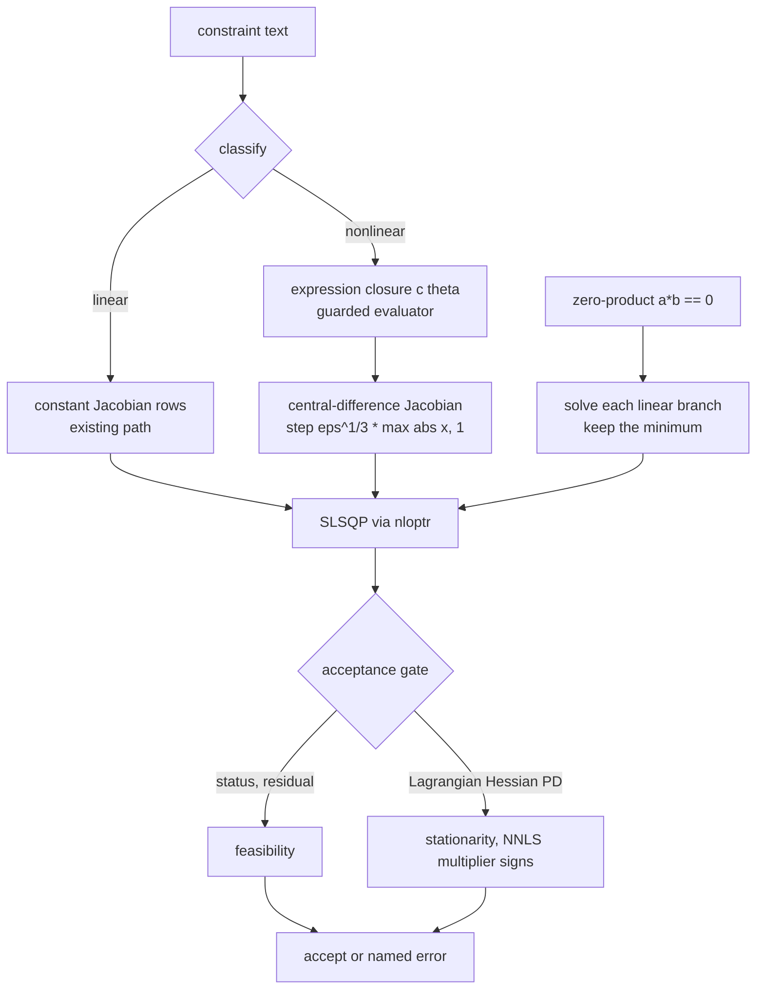

# BRAINSTORM: medfit 0.8.0 (native SEM hardening, lavaan comparison, consistency, ecosystem placement)

**Date:** 2026-10-11 | **Depth:** deep | **Focus:** arch | **Branch:** dev
**Grill ledger:** [GRILL-medfit-0-8-0-2026-10-11.md](GRILL-medfit-0-8-0-2026-10-11.md) (G1-G13)
**Corrected 2026-10-11** after the grill and the Codex and code-review passes; the ledger is authoritative where this file and it differ. Companions: [FEASIBILITY](FEASIBILITY-medfit-0-8-0-additions-2026-10-11.md), [RMediation handoff](HANDOFF-rmediation-mbco-on-mbco_sem-2026-10-11.md).

**Research:** two Opus 5.5 agents (read-only). Their findings are cited below with the
agents' own evidence tags: **[P]** probed, **[C]** code reading, **[R]** reviewer figure never
rerun, **[U]** unverified. Spot-checked by the main session: `fit_mediation()` takes a single
`mediator` string; `SEMFit` has no `tidy()` registration in `R/methods-tidy.R`; CLAUDE.md lists
seven classes (SEMFit is the eighth) and engines "glm, lmer, brms". Everything else is the
agents' report and needs re-verification before it drives a PR.

## Decisions taken in this session (user answers)

| Question | Decision |
|---|---|
| Theme | One release: SEM hardening + consistency audit + lavaan doc, on top of the unreleased dev fixes |
| CRAN | 0.8.0 is GitHub-only (as 0.7.0); `rhub.yaml` is triggered once in parallel with W1 and W3 builds on `Imports` (G4) |
| Nonlinear-constraint bar | OpenMx parity gate on a fixed problem set + KKT checks, with planted defects |
| lavaan doc | pkgdown article that runs both engines at site build; feature table checked by a test |
| Separate SEM package | No unless evidence says otherwise (see Section 3: evidence says no) |
| Breaking changes | Lifecycle deprecation with 2-month notice; correctness fixes exempt (CLAUDE.md) |
| nloptr | Already in Imports and drives SLSQP; nonlinear constraints extend it, no new solver |
| W1 verdict change (G1) | Exempt from deprecation, NEWS behavior-change note |
| W3 scope (G2, G12) | General nonlinear rows, bounded gate; sums of products best-effort with an informational hit rate |
| `mbco` ownership (G10) | RMediation owns the generic; a method on (SEMFit, SEMFit) built on `anova()` and W3; `mbco_sem(fit, a, b)` stays in medfit; medfit exports no `mbco` |
| glm joint test (G11) | Documented recipe only in 0.8.0 (likelihood-ratio families only); the function ships with outcome-scale effects in 0.9.0 |
| k-path MBCO (G13) | Type I error simulation gate with a deterministic p-value oracle before k >= 3 ships |

## 1. Recommended 0.8.0 scope (ordered)

Main risk first: **nonlinear constraints (S25) rest on an S1 review that is not closed**, whose
scripts are neither in git nor on disk, and on an NNLS stationarity gate that was never ported
from the evidence script into `R/` [agent audit]. Do the foundations before the nonlinear step.

| # | Item | Size | Depends on |
|---|---|---|---|
| W1 | Re-derive the S1 findings as committed fixtures in `planning/specs/evidence/native-sem-2026-10-11/` (the `s1-review` scripts are gone from disk and git, G5) and rerun the surviving `04b` stationarity table there; close S1 with a fresh-context review; port the NNLS gate (column scaling, relative tolerance, step guard, dependent-column fixture); unify the bound verdict (plain gate rejects, projected gate only warns, F4). Changes accept/reject on fits 0.7.0 ships: NEWS entry | M | none |
| W2 | Fix F1 (consistent but redundant inequality sets rejected, e.g. `a == b; a - b < 0` fails "status 5") and F2 (`a > 1; a < 0.5` leaks an internal `lb <= ub` assertion); named errors for `Y ~ Y` and duplicate `Y ~ X` rows | S | parallel with W1 |
| W3 | S25 nonlinear constraints: nonlinear rows to closures, central-difference Jacobian, active set and SE projection from the Jacobian at the solution, Lagrangian-Hessian acceptance gate, zero-product branch split for k factors (`b1*b2*b3 == 0` is the union of k linear nulls, G2), best-of-n multi-start with spread warning (**`n_starts` changes from a retry budget to best-of-n: a behavior change that needs a NEWS entry**), sums of products as best-effort (G12). Gates: ~240-run `tests/sim/sem-nonlinear-gate.R` (G6) and `tests/sim/sem-mbco-k-size.R` (G13) | L | W1 |
| W4 | `SEMFit` methods: `tidy()`, `glance()`, `confint()`; report chi-square and df; **`anova()` / a two-model likelihood-ratio test for nested `SEMFit`s (G9), which must detect boundary nulls (an active bound or inequality on a tested parameter) and refuse or warn instead of returning a chi-square p-value, as `mbco_sem()` does today (`R/sem-mbco.R:140-165`)**; decide what `@converged` means (it is always `TRUE` today because a failed fit errors) before `glance()` reports it; one coefficient-naming convention; align argument names (`sampling_weights` vs `weights`, `mbco_sem(fit)` vs `object`) | M to L | none |
| W5 | Docs: CLAUDE.md and AGENTS.md (eight classes, engines table), `methods.qmd` gaps and nonlinear section, NEWS 0.7.0 serial/parallel wording, the lavaan comparison article, the glm joint-significance recipe (G11) | S | W3 and W4 (table rows, nonlinear section) |
| W6 | E1 0.8.x matrix row after release (cross-repo write: ask first) | XS | release |
| Defer | Mean structure and FIML, four-way on native fits, several mediators in `fit_mediation(engine = "native")` | L | later |

### W3 design notes (nonlinear constraints with nloptr)

- **Branch problem** (`a*b == 0`): two local optima (F 0.0952 at a = 0, 0.1061 at b = 0), and
  no local algorithm resolves it. Recommended: detect products fixed at zero and solve each
  linear branch exactly (this is what `mbco_sem()` already does); use best-of-n multi-start with
  a spread warning for other nonlinear rows; add `NLOPT_LD_AUGLAG` only as a fallback for
  status -4, and only if a benchmark shows it helps [agent audit; AUGLAG benchmark [U]].
- Multi-start evidence: SLSQP 34/60 to 56/60 with multi-start, still misses 4 [R]. These numbers (and F 0.0952 / 0.1061 above) are from the n = 300 observed three-variable model, not the RMediation `memory_exp` example, whose diffLLs are 221.05 and 0.083.
- **k-factor products and sums (G2, G12, G13):** `b1*b2*b3 == 0` splits exactly into three linear refits (keep the smallest discrepancy); sums of products (`a1*b1 + a2*b2 == 0`) have no exact split, so they get multi-start, an always-on spread warning, and a hit rate reported (not gated) by the sim gate. A product's gradient vanishes where two or more factors are zero, so the stationarity gate is not meaningful there; test it with a fixture.
- A Lagrangian Hessian `H + sum(lambda * grad^2 c)` is needed in the gate because a product
  constraint is curved; the 0.7.0 gate uses H alone [C].
- `:=` names used inside a constraint (`ab > 0`) become nonlinear and error today [P]: this
  closes with W3.
- Unblocks ecosystem work: probmed's MBCO cannot move onto medfit until nonlinear constraints
  exist (Section 3).

### Failure modes to expose (audit F1-F6)

F1 redundant inequality sets rejected; F2 infeasible bounds give an internal message; F3 first
accepted start wins, so a gate-passing local optimum is returned silently; F4 bound verdict
differs between the plain and projected gates; F5 two simultaneously active inequalities on a
fitted model untested (G1); F6 sign check passes silently when `m'H^-1 m <= 0` [C, U].

## 2. lavaan vs medfit (content for the comparison article)

| Feature | medfit native | Status |
|---|---|---|
| `~ =~ ~~`, labels, fixed values, start/lower/upper | yes | Supported |
| Several modifiers on one term; means, thresholds, `<~`, multigroup, multilevel | no | Unsupported |
| Comma shorthand, `CONSTRAINT()`, fixed exogenous covariates | yes | Different by design |
| Estimators | ML only | Partial |
| Missing data | listwise, no FIML | Partial |
| Categorical indicators | no | Unsupported |
| Information matrix | observed (lavaan: expected) | Different by design |
| Robust SEs and weights | HC0 sandwich; equals lavaan robust SE in a probe (0.04667864) | Supported |
| Linear `== < >` constraints | yes (F1 bug) | Supported |
| Nonlinear constraints | rejected | Unsupported until W3 |
| `:=` defined parameters | values and delta-method SEs; match lavaan to 1e-8 | Supported |
| chi-square, CFI, RMSEA, SRMR | not reported (n*F equals lavaan chi-square 0.9340537 in a probe) | Unsupported until W4 |
| logLik, AIC, BIC | means counted in df | Different by design |
| Standardized estimates, modification indices, fitted, residuals | no | Unsupported |
| Mediation extraction and MBCO | yes, no four-way; `mbco_sem()` is medfit-only | Supported |
| Speed (n = 300, 20 reps, one machine) | 5.5 vs 10.9 ms observed; 8.4 vs 20.4 ms latent | [P] |

Article plan: run both engines on `mediation_demo` at site build; a test asserts every table
row's status against a live probe (pattern: the cookbook consistency tests).

## 3. Ecosystem placement: no separate SEM package

**Evidence against a split** (agent survey, cited file paths need re-verification):
1. Native route reuses medfit's lavaan extraction workers through an accessor seam; a sibling
   would need that seam exported or the 1263-line worker file duplicated.
2. `fit_mediation(engine = "native")` and the SEMFit class are wired into medfit (`zzz.R`).
3. No dependent uses `fit_sem`, `SEMFit` or `mbco_sem` yet; missingmed plans to (J8).
4. SEM adds one hard dependency (nloptr); OpenMx stays Suggests.
5. The grill ledger decided "build in medfit" (J1).

**Revisit a split only if** a dependent needs SEM without the rest of medfit, or the CRAN check
of nloptr forces it. If nloptr fails CRAN checks the fallback is Suggests behind
`requireNamespace()`, not a package split. **nloptr status (G4):** `R-CMD-check` already runs it on macOS, Windows, three Ubuntu configurations and a noSuggests job, all green at 67b6db8; only exotic CRAN flavors are untested, and `rhub.yaml` is triggered once in parallel with W1.

**Consolidation targets** (all through lifecycle deprecation; in 0.8.0 only the medfit-side API and the RMediation `mbco()` route, a separate RMediation-rooted session blocked on W3 and `anova()` (G3, G7, G10); the RMediation CRAN release waits for medfit on CRAN, G3b):

| Pkg | Move | Notes |
|---|---|---|
| RMediation | Add an `mbco()` method on (SEMFit, SEMFit) built on `anova()` and W3 (G10); keep the OpenMx path (it stays Suggests, and `mbco()` takes OpenMx models and has bootstrap types); separate tickets: `ci_medfit.R` reuse `.path_se()`, the hard lavaan Import (used for `lav_matrix_vech_reverse`, not MBCO) | additive, not a replacement; see the HANDOFF |
| medsim | Delegate copied a/b fits, Sobel SE, Rubin variance, MBCO, MC CI to owners; `methods_pmed.R` mislabeled MBCO | largest duplication |
| probmed | Bootstrap re-implements `bootstrap_mediation()`; depends on internal `m_<pred>`/`y_<pred>` names | MBCO there is a different estimand, blocked on W3 |
| medfit | Export a sanctioned API: coefficient-name contract and a pooled-object constructor | replaces internals probmed and missingmed lean on (`pool.R:130-134` nulls `@data`/`@sigma_m` to pass the validator) |
| all | One `tidy` generic (`generics::tidy`); RMediation defines its own, missingmed re-exports broom's | masking order issue, dispatch failure unverified |
| medrobust | Manifest says "suggests medfit" but DESCRIPTION has none; `*_legacy` simulation code looks dead | housekeeping |
| mediationverse | missingmed absent from the meta-package | housekeeping |

## 4. Test plan (red-first; tiers by change shape)

| Tier | Plan |
|---|---|
| unit | NNLS gate on dependent columns (the 0/0 case); F1, F2 fixtures; `Y ~ Y` and duplicate-row errors; bound-verdict parity (F4) |
| integration | ~240-run OpenMx-parity gate `tests/sim/sem-nonlinear-gate.R` (4 problems x 3 models x 2 sample sizes x 10 seeds; pass rule in G6); KKT checks; planted defect (nonlinear row misclassified as linear must be caught); G1 fixture `a+b<0.2; a-b<0.1`; best-of-n on a two-optima latent model; `:=` inside a constraint; a three-factor product and one sum-of-products problem; boundary-null fixture for `anova()` preserving the `mbco_sem()` warning (G9); type I error gate `tests/sim/sem-mbco-k-size.R` with a deterministic oracle (statistic 4 at alpha 0.05: p = 0.0455 at df 1, 0.1353 at df 2) and a power floor (G13) |
| e2e | lavaan article builds and its table matches live probes; `SEMFit` `tidy`/`glance`/`confint` against lavaan |
| dependency | `rhub.yaml` once during W1 (G4); revdep run of probmed and RMediation suites against dev; RMediation parity fixture on `memory_exp` (known answers 221.045546, 0.083100) |
| count-cascade | pkgdown reference lists every export; refcard names every export and class |

Stubs TODO(author): delete if not contract-bearing. Per `e2e-before-pr`, each behavior PR needs
a transcript of a run that can fail.

## 5. Documentation

CHANGELOG/NEWS `[Unreleased]` entries for W1 (verdict change), W3, W4; `methods.qmd` (near-singular
rejection, bound verdict split, nonlinear section); `?"medfit-syntax"` nonlinear constraint
syntax; the lavaan comparison article and Models menu entry; CLAUDE.md and AGENTS.md (eight
classes, engines table); cookbook recipe for nonlinear MBCO; the glm joint-significance recipe on the GLM families page and in the cookbook, restricted to likelihood families (`quasibinomial`/`quasipoisson` and estimated-dispersion families get a Wald or F procedure, G11); a NEWS note that `n_starts` becomes best-of-n. Version and count lines stay in the
release step.

## 6. Open questions: resolved in the grill

| Question | Resolved as |
|---|---|
| W1 verdict change exempt from deprecation? | Yes, with a NEWS note (G1) |
| Zero-product split only, or general nonlinear rows? | General rows, bounded gate (G2); sums best-effort (G12) |
| Which consolidation moves start in 0.8.0? | Medfit-side API plus the RMediation route in a separate session (G3, G3b, G7, G10) |
| nloptr CRAN-flavor check before or after W3? | `rhub.yaml` in parallel with W1; build W3 on Imports (G4) |
| Where do the S1 scripts live? | They are gone; re-derive as fixtures in a new evidence folder (G5) |

No question from this file remains open. Left for the plan: exact gate fixtures (G6), the
`anova()` design details in G9 (nesting check, df with active constraints, bootstrap LRT).

## Recommended next step

Cut the plan (`/craft:plan`) from this file and the ledger. W1 and W2 can start in parallel:
they are small, independent of the nonlinear design, and their fixtures de-risk W3. The
RMediation `mbco()` route waits for `anova()` (W4) and W3.
