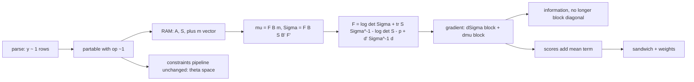

# BRAINSTORM: Mean structure for the native SEM engine

**Date:** 2026-10-12 | **Mode:** deep, focus `arch` | **Branch at start:** `dev` (0.8.0)
**Topic:** let `fit_sem()` and `fit_mediation(engine = "native")` fit models with intercepts and means (`y ~ 1`), so the engine is no longer covariance-only.

## Decisions (from the question round)

| # | Question | Decision |
|---|---|---|
| 1 | Scope | **Full lavaan `meanstructure`**: observed intercepts, exogenous means, and latent means/intercepts with identification rules. Largest option; chosen over the recommended observed-only v1. |
| 2 | Parameterization | **Extend RAM with an `m` vector**: `mu = F (I - A)^-1 m`. One theta vector, one free-index map, same constraint pipeline. |
| 3 | Oracle | **lavaan `meanstructure = TRUE` + OpenMx + planted defect** (drop the `dmu` term; the gradient check must catch it). |
| 4 | Weights / sandwich | **Supported in v1.** Scores and weighted means include the mean block. |
| 5 | Four-way via native | **Deferred** to a follow-up PR that reuses the mean machinery for `E[M | X = 0]`. |
| 6 | Switch | **Auto on `~1`, plus explicit `meanstructure` argument.** Models without `~1` keep today's covariance-only fit, `logLik`, and AIC. |

## What the code does today (anchors)

- `R/sem-model.R:136` `.sem_to_ram()` stops on any `~1` that is free or fixed nonzero ("mean structure is not supported"). Fixed-zero intercepts are dropped.
- `R/sem-ml.R:104` `.sem_sample()` centers the data at the sample mean and keeps only `S`. The means are implicitly **saturated and unrelated to theta**.
- `R/sem-ml.R:171` `.sem_eval()` computes `F = log|Sigma| + tr(S Sigma^-1) - log|S| - p` and the gradient through `W = Sigma^-1 - Sigma^-1 S Sigma^-1`.
- `R/sem-sandwich.R` documents the consequence: "the means are free and unrelated to theta, so A is block diagonal and only the theta block of B enters." **That sentence stops being true** with a mean structure that depends on theta (a path from X to Y carries into `mu_y`).
- `R/sem-model.R:178` `.sem_df()` counts `p(p+1)/2` moments only.

## Architecture

B = (I - A)^-1, d = xbar - mu(theta).

### 1. Discrepancy and gradient (the core change)

- Add `d' Sigma^-1 d` to `F`. The covariance gradient keeps its form with **S replaced by S + d d'**: `W = Sigma^-1 - Sigma^-1 (S + d d') Sigma^-1`. One substitution carries the existing `dSigma` path unchanged.
- New mean block: `dF/dtheta_k = -2 (dmu/dtheta_k)' Sigma^-1 d`. With `dmu/dm_j = F B e_j` and `dmu/dA_ij = F B E_ij B m`.
- `.sem_sample()` must keep the (weighted) sample mean `xbar` and the raw, **uncentered** data. `xc` can no longer be centered at the sample mean for the scores: they need `x_i - mu(theta)`.
- With saturated, unconstrained intercepts the ML mean equals the sample mean, so covariance-parameter estimates equal the covariance-only fit. This is an exact regression check (a free test of correctness).

### 2. Information and standard errors

- Expected information gains the mean block `(dmu)' Sigma^-1 (dmu)`; the cross block vanishes only when the mean parameters are unrelated to covariance parameters at the ML point under normality. With theta-dependent means the full matrix is needed. Do not assume block diagonality.
- `.sem_info_observed()` via finite differences of the gradient keeps working once the gradient is right.
- Sandwich: `.sem_scores()` adds `w_i * (dmu_k)' Sigma^-1 (x_i - mu)` to each covariance score. Scale invariance of the weights still holds.

### 3. Latent means (the scope choice with the most risk)

- lavaan single-group default: latent means fixed at 0, indicator intercepts free. A free `eta ~ 1` is identified only if one indicator intercept is fixed or constrained (the intercept analogue of `.sem_check_scale()`).
- Needs a new identification check at table-completion time, with a message naming the latent variable, parallel to "its scale is not set".
- **To verify against lavaan before coding:** exactly which rows lavaan auto-fixes under `meanstructure = TRUE` for latent variables with and without `~1`.

### 4. Counts, `anova()`, `mbco_sem()`

- Moments become `p(p+1)/2 + p`. Saturated free intercepts add `p` parameters and `p` moments, so df is unchanged versus the covariance-only fit. Constrained intercepts change df.
- `anova()` must **refuse** to compare fits with different `meanstructure` status (the discrepancy is not on the same scale).
- `mbco_sem()` clean-start null refits are in theta space and should carry intercepts; test that a null on an intercept-bearing path still passes the acceptance gate.
- The existing finding that explicit equality constraints are not subtracted from model df (equivalent models get different AIC) is adjacent and pre-existing; do not entangle it with this change.

### 5. Constraints pipeline

- Intercept rows are ordinary theta entries, so linear and nonlinear `==`, `<`, `>` and `:=` work unchanged (`R/sem-constraints.R`). New cases to test: `a*b` nonlinear constraints where one factor involves an intercept; the redundancy rule (`.sem_independent_rows()`) with intercept equalities.

### 6. Surface and naming

- Coefficient names follow lavaan: `y~1`. `coef()`, `vcov()`, `tidy()`, `glance()` gain intercept rows; `extract_mediation(<SEMFit>)` must skip them (alias rows are looked up by name, so check `.path_se()`).
- Adds a `meanstructure` flag on `SEMFit`. `logLik()` includes the mean term only when the flag is on.

## Risks

| Risk | Severity | Mitigation |
|---|---|---|
| Block-diagonal assumption left in `sem-se.R`/`sem-sandwich.R` | High | Audit both; planted defect = zero the cross block, gate must catch it |
| Latent-mean identification mistakes | High | lavaan comparison table per model form; refuse unidentified models by name |
| Scope creep (largest option chosen) | Medium | Phase the work: observed-variable intercepts land and are verified before latent means |
| `anova()`/AIC comparability across on/off | Medium | Explicit refusal with a message |
| SLSQP behavior with intercepts under nonlinear constraints | Medium | Reuse `tests/sim/sem-nonlinear-gate.R` with intercept variants |
| OpenMx as an extra Suggests/test dependency | Low | Already used for the 0.7.0 parity gate; `skip_if_not_installed()` |

## Test plan (red-first stubs)

| Tier | Content |
|---|---|
| unit | Parser accepts `y ~ 1`, `y ~ 0*1`, labels on intercepts; gradient and information against finite differences with a mean structure; `S + d d'` identity |
| regression | Saturated free intercepts reproduce covariance-only estimates, SEs, df, and chi-square exactly |
| integration | `fit_mediation(engine = "native")` and `fit_sem()` with intercepts, weights, `se_type = "sandwich"`, `mbco_sem()`, `anova()` |
| dependency | lavaan `meanstructure = TRUE` parity (estimates, SEs, logLik, sandwich with `sampling.weights`); OpenMx independent optimum |
| planted defect | Drop `dmu` in the gradient; zero the information cross block; center scores at the sample mean. Each must fail a named test. N/A: count-cascade (no new command/skill/agent) |

## Documentation

Hand-scored against the doc-impact rubric's categories (the scorer was not run in this session):

- [x] NEWS.md `[Unreleased]` entry (behavior change: the "not supported" error becomes a feature)
- [x] `?"medfit-syntax"` (`R/sem-syntax-help.R`) and `man/fit_sem.Rd` ("Mean structures are not supported" at `R/fit-sem.R:21`)
- [x] `vignettes/articles/model-native.qmd`, `native-guide.qmd`, `model-native-multi.qmd`, `guide-troubleshooting.qmd` (each states "no mean structure")
- [x] lavaan comparison article feature table (probed live by `test-lavaan-comparison.R`; the row flips)
- [x] `vignettes/articles/methods.qmd` (the discrepancy with the mean term and the `S + d d'` form)
- [x] CLAUDE.md Engines table ("no four-way, no mean structure") and `.STATUS`
- N/A: demo, mermaid diagram in the docs (internal architecture only)

## Recommended next step

**Review the SPEC, then start with phase 1 (observed intercepts)** before latent means: it exercises the whole gradient/information/score change on the simplest identification story and gives the lavaan oracle a clean first target.

## Open questions

1. Which rows does lavaan auto-fix for latent variables under `meanstructure = TRUE` (verify before phase 3)?
2. Does `.sem_step_floor()` (`R/sem-ml.R:278`) need a mean term for its stability bound?
3. Should `fit_mediation(engine = "native")` expose `meanstructure =` directly, or only through `model` syntax?
